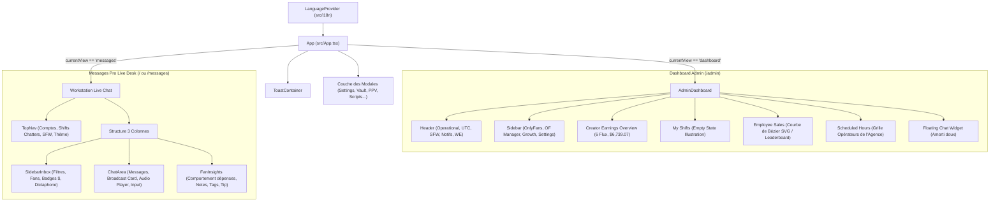

# Architecture Technique — CactusClub SaaS

Documentation complète de l'architecture logicielle, de l'organisation des composants et des flux de données.

---

## 1. Vue d'Ensemble & Vision Système

CactusClub intègre harmonieusement les 3 facettes indissociables d'un écosystème d'agence moderne : l'**Expérience Fan/Visiteur**, la **Console Opérateur Chatter** et la **Business Intelligence Agence** :

```mermaid
flowchart TD
    User([Utilisateur / Visiteur / Chatter / Admin]) --> Router{Moteur de Routage SPA}
    
    Router -->|"/" ou "/fan"| FanView["Portail Fan & Visiteur (Chat, PPV, Abonnements, Wallet)"]
    Router -->|"/messages"| ChatView["Station Live Chat (Messages Pro Chatter Console)"]
    Router -->|"/admin"| AdminView["Dashboard Admin (Business Intelligence & Direction)"]
    
    subgraph "Couche Globale Partagée"
        I18n["i18n Context (FR / EN / ES / DE)"]
        Audio["Web Audio Synthesizer Engine (0ms Latency)"]
        Theme["Theme (Light/Dark) & SFW Privacy Engine"]
        Modals["Modals Unifiés (Vault, PPV, Scripts, Settings, Subscriptions, Tips)"]
    end
    
    FanView -.-> Audio
    FanView -.-> Theme
    FanView -.-> Modals
    
    AdminView -.-> I18n
    AdminView -.-> Audio
    AdminView -.-> Modals
    
    ChatView -.-> I18n
    ChatView -.-> Audio
    ChatView -.-> Modals
```

---

## 2. Cartographie de l'Arborescence (`src/`)

```
cactusclub/
├── public/
│   ├── _redirects                  # Redirections SPA (Netlify / Cloudflare Pages)
│   ├── favicon.svg                 # Identité visuelle
│   └── icons.svg
├── src/
│   ├── assets/                     # Médias et logos statiques
│   ├── components/                 # Composants d'interface modulaires
│   │   ├── fan/                    # Expérience Fan / Visiteur
│   │   │   ├── FanAuthModal.tsx    # Modal Inscription / Connexion avec démo $150
│   │   │   ├── FanChatView.tsx     # Messenger en direct avec Margot & lecteur de PPV
│   │   │   ├── FanPortal.tsx       # Vitrine créatrice, profil, feed et gestion de solde
│   │   │   ├── FanSubscribeModal.tsx # Sélecteur d'abonnements (1 mois, 3 mois, VIP)
│   │   │   └── FanTipModal.tsx     # Modal d'envoi de pourboires personnalisés
│   │   ├── AddAccountModal.tsx     # Modale d'ajout de compte créateur
│   │   ├── AdminDashboard.tsx      # Dashboard Admin complet (Bézier, Stats, Shifts)
│   │   ├── BroadcastModal.tsx      # Modale de campagne DM en masse
│   │   ├── ChatArea.tsx            # Flux central de discussion en direct
│   │   ├── FanInsights.tsx         # Volet CRM latéral droit (profil, dépenses, notes)
│   │   ├── GifModal.tsx            # Sélecteur de médias animés
│   │   ├── MediaLightbox.tsx       # Visionneuse d'images grand écran
│   │   ├── PPVModal.tsx            # Générateur de médias verrouillés PPV
│   │   ├── ScheduleModal.tsx       # Programmateur d'envois automatiques
│   │   ├── ScriptsModal.tsx        # Bibliothèque de réponses types & raccourcis "/"
│   │   ├── SettingsModal.tsx       # Paramètres globaux, commissions & Shield AI
│   │   ├── SidebarInbox.tsx        # File d'attente fans gauche avec filtres et audio
│   │   ├── Toast.tsx               # Conteneur de notifications flottantes
│   │   └── TopNav.tsx              # Barre supérieure (comptes, shifts, SFW, i18n)
│   ├── data/
│   │   └── mockData.ts             # Jeu de données réaliste, créateurs, fans et scripts
│   ├── i18n/
│   │   ├── LanguageContext.tsx     # Contexte React avec persistance localStorage
│   │   └── translations.ts         # Dictionnaire multilingue (FR, EN, ES, DE)
│   ├── types/
│   │   └── crm.ts                  # Définitions TypeScript strictes
│   ├── utils/
│   │   └── sound.ts                # Synthétiseur audio natif (Web Audio API)
│   ├── App.tsx                     # Routeur d'état central & orchestration globale
│   ├── index.css                   # Tailwind CSS v4, animations & glassmorphism
│   └── main.tsx                    # Point d'entrée de montage React DOM
├── vercel.json                     # Configuration de réécriture d'URL SPA (Vercel)
├── vite.config.ts                  # Configuration du bundler Vite & Tailwind v4
└── package.json                    # Dépendances et scripts de build
```

---

## 3. Hiérarchie des Composants



---

## 4. Routage Hybride & Performance

* **Routage History API** : Les URLs directes `/admin` et `/messages` sont capturées immédiatement par `getViewFromLocation()` sans librairie tierce superflue, éliminant les problèmes de compatibilité React 19.
* **Navigation $O(1)$** : Les messages et les profils sont indexés par identifiant (`messagesMap[selectedFanId]`), garantissant zéro latence lors du basculement d'un fan à un autre au milieu d'une centaine de conversations actives.
* **Audio Web Natif** : Aucun fichier `.mp3` lourd à télécharger ; les sons d'envoi, de réception et d'encaissement de pourboires sont générés en direct par synthèse de fréquences via l'oscillateur Web Audio natif.

